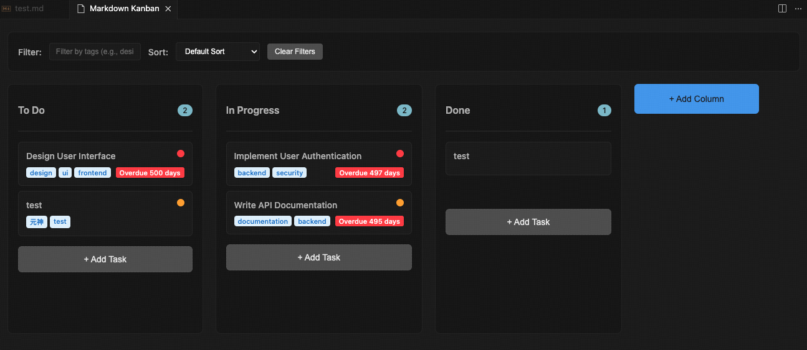

# Markdown Kanban
> Made by cursor

A powerful VS Code extension that transforms Markdown files into interactive Kanban boards, supporting task management, drag-and-drop operations, and rich task attributes.

## ✨ Features

### 📋 Basic Features
- **Markdown Parsing**: Automatically parses task lists from Markdown files.
- **Kanban View**: Displays tasks in a Kanban board format with multi-column layout.
- **Drag & Drop**: Supports dragging and dropping tasks between different columns.
- **Real-time Sync**: Ensures real-time, two-way synchronization between the Kanban board and the Markdown file.

### 🎯 Task Management
- **Task Collapse/Expand**: Tasks are collapsed by default, showing only the task name, priority, and tags. Click to expand for details.
- **Priority Support**: Supports three priority levels: High (🔴), Medium (🟡), and Low (🟢).
- **Workload Support**: Supports four workload levels: Easy (🟢), Normal (🟡), Hard (🔴), and Extreme (🔴🔴).
- **Steps Support**: Supports steps for task management, using `- [ ] step` format.
- **Tagging System**: Supports multiple tags for categorization, using `#tagname` or `[tag1, tag2]` format.
- **Time Management**:
  - Due Date: `due:YYYY-MM-DD`
- **Task Description**: Supports multi-line detailed descriptions, including the new code block format.

### 🆕 Task Format
Supports a structured task format for better readability and organization:
- **Structured Attributes**: Task attributes use an indented list format.
- **Code Block Descriptions**: Use ```` ```md ```` code blocks for detailed descriptions.
- **Array Tags**: Tags support `[tag1, tag2, tag3]` array format.
- **Backward Compatibility**: Fully compatible with the old inline format.

### 🔍 Filtering & Sorting
- **Tag Filtering**: Filter tasks by tags; multiple tags (comma-separated) are supported.
- **Multiple Sorting Options**: Sort by Task Name, Due Date, Priority, etc.
- **Clear Filters**: One-click to clear all filtering and sorting conditions.

### 🖥️ UI Features
- **Editor Panel**: Full Kanban editing interface that follows the active Markdown file when file switching is enabled.
- **Modern UI**: Adheres to VS Code design guidelines and supports theme switching.
- **Responsive Design**: Adapts to different screen sizes.
- **Task Terminals**: Start Codex, Claude Code, or another configured binary directly from a task card.
- **Multiple Todo Boards**: Switch between `*.todo.md`, `*.kanban.md`, and `TODO.md` files in one workspace.
- **Agent Skill**: Copy the GitHub-based install command from the board toolbar.

### Task Terminal Settings

Use **Terminal settings** in the board toolbar to configure the executable, one startup argument per line, environment variables, and the task prompt template. Environment variables are stored in VS Code SecretStorage for the current workspace. Task terminals only start in trusted workspaces.

### Markdown Kanban Skill

The reusable skill lives at `skills/markdown-kanban`. Install it from GitHub with:

```bash
npx skills add https://github.com/holooooo/markdown-kanban --skill markdown-kanban
```

The skill searches for multiple todo boards before editing and uses the same Markdown format as this extension.

## 🚀 Quick Start

### Installation
1. Search for "Markdown Kanban" in the VS Code Extension Marketplace.
2. Click Install.

### How to Use

#### 1. Create a Markdown Kanban File

```markdown
# My Project Board

## To Do

### Design User Interface

  - due: 2024-01-15
  - tags: [design, ui, frontend, backend]
  - priority: high
  - workload: Hard
  - defaultExpanded: true
  - steps:
      - [x] asd
      - [x] xgfs
    ```md
    Design user login and registration pages, including:
    - Responsive layout design
    - Brand color application
    - User experience optimization
    ```

### Write API Documentation

  - due: 2024-01-20
  - tags: [documentation, backend]
  - priority: medium
    ```md
    Write complete REST API documentation using OpenAPI 3.0 specification.
    Include request and response examples for all endpoints.
    ```

## Done

### Project Initialization

  - due: 2024-01-05
  - tags: [setup]
  - priority: low
```

#### 2. Open Kanban View
- **Method 1**: Right-click on the Markdown file → Select "Kanban"
- **Method 2**: Use the Command Palette (`Ctrl+Shift+P` or `Cmd+Shift+P`) → Type "Open Kanban Board"
- **Method 3**: Use the board picker in the Kanban toolbar to switch between todo files.

#### 3. Use Filtering and Sorting
- **Tag Filtering**: Enter tag names in the top filter box (e.g., design,ui).
- **Sorting**: Use the sort dropdown menu to select a sorting method.
- **Clear**: Click the "Clear Filters" button to reset all conditions.

#### 4. Task Operations
- **View Task**: Click on a task card to expand/collapse detailed information.
- **Move Task**: Drag and drop tasks to different columns.
- **Edit Task**: Click the "Edit" button on a task.
- **Delete Task**: Click the "Delete" button on a task.
- **Add Task**: Click the "+ Add Task" button at the bottom of a column.

#### 5. Column Management
- **Hide Column**: Click the eye icon on the right side of the column title.
- **Show Hidden Columns**: Click the "Manage Columns" button and enter the column number when prompted.
- **Reorder Columns**: Drag and drop column titles to reorder them.

#### 6. Enable or Disable File Switching
- **Change the setting**: Use the Command Palette (`Ctrl+Shift+P` or `Cmd+Shift+P`) → Type "Enable/Disable File Switcher"
